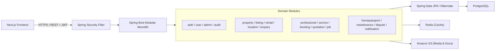
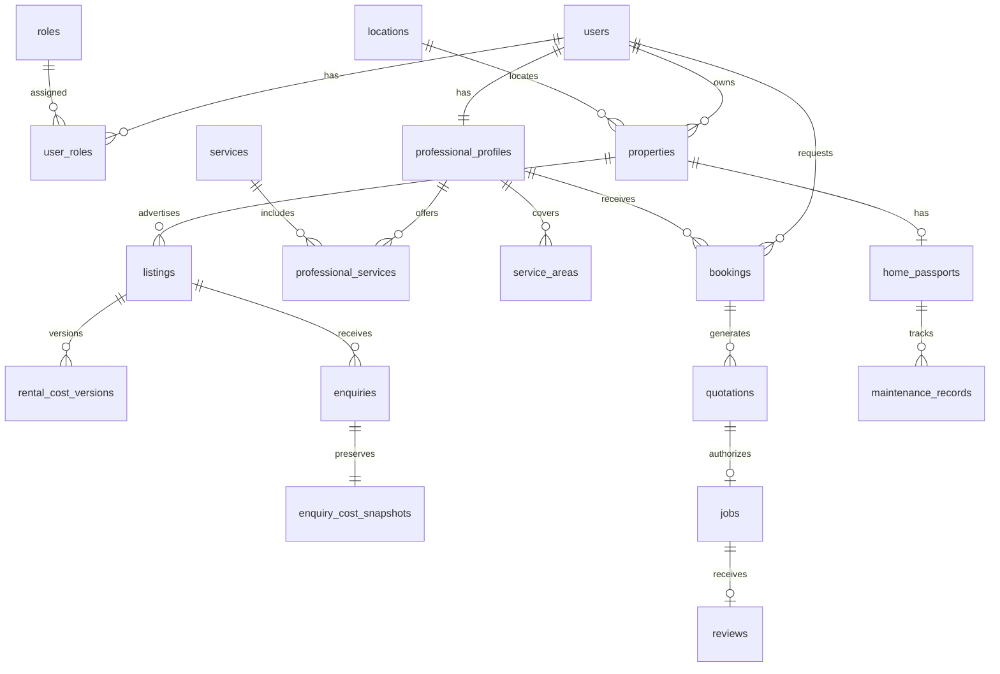
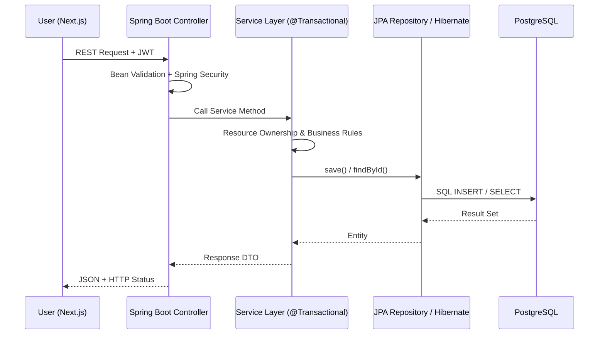

# Backend Architecture and Database Design

> **Project:** Local Living & Service Hub  
> **Status:** Architecture & Database Design Specification (No application code or SQL migrations implemented yet)

---

## 1. Complete Backend Architecture

### Selected Backend Technologies
- **Java (LTS):** Primary backend programming language.
- **Spring Boot:** Core application framework providing dependency injection, auto-configuration, and embedded web server.
- **Spring Security:** Authentication (JWT + refresh tokens) and authorization (RBAC + resource-level ownership).
- **Spring Data JPA & Hibernate:** Object-Relational Mapping (ORM) and repository abstraction over PostgreSQL.
- **Bean Validation:** Declarative DTO validation (`@NotNull`, `@Size`, etc.).
- **Maven:** Build automation and dependency management (`pom.xml`).
- **PostgreSQL:** Primary relational database and single source of truth.
- **Flyway:** Versioned SQL database migrations.
- **Redis:** In-memory caching for discovery queries and coordination tasks.
- **Docker & Docker Compose:** Containerized local development environment.

### Modular Monolith Architecture
- **What it means:** A single deployable Spring Boot application where code is organized into well-defined, independent domain modules (`auth`, `user`, `property`, `listing`, `rental`, etc.) rather than separate network-distributed services.
- **Why it is suitable:** Keeps deployment, local development, debugging, and database transactions simple while enforcing clean domain boundaries.
- **How modules are separated:** Each module owns its own `controller`, `service`, `repository`, `entity`, and `dto` packages. Cross-module communication happens through Spring service interfaces/beans rather than direct cross-module repository access.
- **Why not microservices initially:** Microservices add network latency, distributed transaction complexity, and operational overhead without immediate user value.
- **Frontend Communication:** The Next.js frontend communicates with the Spring Boot backend exclusively over **HTTPS/REST** (`/api/v1/...`) using JSON payloads and JWT Bearer tokens.



---

## 2. Backend Folder Structure

```text
backend/
└── src/
    ├── main/
    │   ├── java/com/localliving/
    │   │   ├── config/          # Spring Security, CORS, Redis, S3, Jackson config
    │   │   ├── common/          # Shared exceptions, ApiResponse, pagination, base entities
    │   │   ├── auth/            # Initial: Registration, login, JWT
    │   │   ├── user/            # Initial: Profiles, roles
    │   │   ├── property/        # Initial: Physical homes & images
    │   │   ├── listing/         # Initial: Property advertisements & status
    │   │   ├── rental/          # Initial: Rental cost versions & items
    │   │   ├── location/        # Initial: Coimbatore localities & addresses
    │   │   ├── enquiry/         # Initial: Enquiries, cost snapshots, visit requests
    │   │   ├── booking/         # Initial: Service booking requests
    │   │   ├── professional/    # Initial: Professional & business profiles
    │   │   ├── service/         # Initial: Service categories & offerings
    │   │   ├── admin/           # Initial: Moderation & approvals
    │   │   ├── audit/           # Initial: Immutable audit logs
    │   │   ├── notification/    # Initial: Email / in-app / WhatsApp deep links
    │   │   ├── quotation/       # Gen 2: Structured quotes & versions
    │   │   ├── job/             # Gen 2: Job execution & status history
    │   │   ├── document/        # Gen 2: Secure document & evidence metadata
    │   │   ├── review/          # Gen 2: Customer reviews
    │   │   ├── homepassport/    # Gen 2: Digital Home Passport & access grants
    │   │   ├── maintenance/     # Gen 2: Maintenance records & reminders
    │   │   └── dispute/         # Gen 2: Complaints & dispute resolution
    │   └── resources/
    │       ├── application.yml  # Environment-driven configuration
    │       └── db/migration/    # Flyway SQL scripts (V1__..., V2__...)
    └── test/                    # JUnit 5, Mockito, Testcontainers tests
```

> **Note:** Modules should be created only when their development phase begins. Do not create empty future modules prematurely.

### Standard Module Layering (Example: `property/`)
```text
property/
├── controller/   # HTTP endpoints, DTO validation, calls Service
├── service/      # Business logic, ownership checks, @Transactional
├── repository/   # Spring Data JPA interfaces extending JpaRepository
├── entity/       # JPA @Entity classes mapped to PostgreSQL tables
└── dto/          # Request/Response records/classes (never expose entities directly)
```
- **Practical Property-Creation Example:** `PropertyController` receives `POST /api/v1/properties` with `CreatePropertyRequest` (validated by Bean Validation) → `PropertyService` verifies the authenticated user holds `OWNER`, maps DTO to `Property` entity, calls `PropertyRepository.save()` → Hibernate executes `INSERT INTO properties` → returns `PropertyResponse` DTO.

---

## 3. Backend Modules Breakdown

| # | Module | Purpose & Responsibilities | Interacts With | Key Business Rules | Scope |
| :-: | :--- | :--- | :--- | :--- | :--- |
| 1 | **Authentication (`auth`)** | Registration, login, JWT & refresh tokens. | `user`, `audit` | Passwords hashed; stateless JWT auth. | **Initial (Gen 1)** |
| 2 | **User Management (`user`)** | User profiles, `CUSTOMER`/`OWNER`/`PROFESSIONAL`/`ADMIN` roles. | `auth`, `admin` | One user can hold multiple roles. | **Initial (Gen 1)** |
| 3 | **Property (`property`)** | Physical homes, bedrooms, amenities, photos. | `user`, `location`, `listing` | Only owning `OWNER` or authorized broker can edit. | **Initial (Gen 1)** |
| 4 | **Listing (`listing`)** | Property advertisements, availability status, `last-confirmed` date. | `property`, `rental`, `admin` | Unavailable listings must not appear as available. | **Initial (Gen 1)** |
| 5 | **Rental Cost (`rental`)** | Monthly rent, maintenance, deposit, brokerage, version history. | `listing`, `enquiry` | Updates create new versions; history preserved. | **Initial (Gen 1)** |
| 6 | **Location (`location`)** | Coimbatore localities, areas, addresses. | `property`, `professional` | Standardized locality filtering. | **Initial (Gen 1)** |
| 7 | **Enquiry (`enquiry`)** | Customer enquiries, cost snapshots, property visit requests. | `listing`, `rental`, `user`, `notification` | Must preserve rental cost snapshot at submission. | **Initial (Gen 1)** |
| 8 | **Booking (`booking`)** | Service booking requests and slot/capacity coordination. | `user`, `professional`, `service`, `notification` | Concurrency protection prevents double-booking. | **Initial (Gen 1)** |
| 9 | **Professional (`professional`)** | Independent & business profiles, skills, service areas, availability. | `user`, `service`, `location` | Evidence-based qualifications, not legal guarantees. | **Initial (Gen 1)** |
| 10 | **Service (`service`)** | Service categories and specific service offerings. | `professional`, `booking` | Categorized discovery by locality. | **Initial (Gen 1)** |
| 11 | **Notification (`notification`)** | Email, in-app, and WhatsApp deep-link notifications. | All transactional modules | Retries and idempotency for reliable delivery. | **Initial (Gen 1)** |
| 12 | **Admin (`admin`)** | Listing moderation, user/professional review, approvals. | `listing`, `user`, `audit`, `dispute` | All admin actions logged in `audit`. | **Initial (Gen 1)** |
| 13 | **Audit (`audit`)** | Immutable log of price changes, status changes, approvals. | All modules | Records cannot be altered after creation. | **Initial (Gen 1)** |
| 14 | **Quotation (`quotation`)** | Structured quotes (labour, materials, taxes, validity) & versions. | `booking`, `job`, `notification` | Work starts only after customer approves exact version. | **Later (Gen 2)** |
| 15 | **Job (`job`)** | Job lifecycle (`SCHEDULED` → `IN_PROGRESS` → `COMPLETED` → `CLOSED`). | `quotation`, `document`, `review` | Explicit state transitions; extra work needs approval. | **Later (Gen 2)** |
| 16 | **Document (`document`)** | Metadata & controlled access for S3 invoices, photos, evidence. | `property`, `job`, `homepassport` | Time-limited, permission-checked access. | **Later (Gen 2)** |
| 17 | **Review (`review`)** | Customer ratings/reviews after job completion. | `job`, `professional`, `user` | Linked to completed jobs only. | **Later (Gen 2)** |
| 18 | **Home Passport (`homepassport`)** | Property lifecycle record, appliance inventory, tenant access grants. | `property`, `maintenance`, `document` | Revocable access; no previous-tenant PII exposed. | **Later (Gen 2)** |
| 19 | **Maintenance (`maintenance`)** | Repair history, warranties, maintenance reminders. | `homepassport`, `job`, `notification` | Manual records supported without sensors. | **Later (Gen 2)** |
| 20 | **Dispute (`dispute`)** | Customer/provider complaints, evidence, admin resolution. | `booking`, `quotation`, `job`, `admin` | Links quote, approvals, photos, and invoice. | **Later (Gen 2)** |

---

## 4. Complete Database Architecture (PostgreSQL)

- **Relational Model:** Data is organized into normalized tables with rows and columns.
- **Identifier Strategy:** Consistent `BIGINT` (auto-increment / identity) or `UUID` primary keys across all tables *(proposed: `BIGINT GENERATED ALWAYS AS IDENTITY` for internal PKs, or `UUID` if public IDs are preferred — to be finalized in Phase 1)*.
- **Constraints:** `PRIMARY KEY`, `FOREIGN KEY` (referential integrity), `UNIQUE`, `NOT NULL`, and `CHECK` constraints (e.g., monetary values `>= 0`).
- **Relationships:** One-to-One, One-to-Many, and Many-to-Many (via join tables like `user_roles`, `professional_services`).
- **Data Types:**
  - `VARCHAR` / `TEXT` for strings.
  - `NUMERIC(12, 2)` for all monetary values (never `FLOAT` or `DOUBLE` to avoid rounding errors).
  - `BOOLEAN` for flags.
  - `DATE`, `TIME`, and `TIMESTAMP WITH TIME ZONE` for temporal data.
  - `JSONB` only when structured flexible metadata is genuinely required.
- **Indexes & Transactions:** Indexes on foreign keys, locality, rent, and status columns. Spring `@Transactional` ensures ACID atomicity.
- **Auditing & Soft Deletion:** `created_at` and `updated_at` on all tables; soft deletion (`deleted_at`) only where historical references must remain intact (e.g., properties with past enquiries).
- **Flyway:** Manages all schema changes via versioned SQL scripts in `db/migration/`.

---

## 5. Database Table Design (Proposed Schema)

| Domain | Table | Purpose | Key Columns & Types | Scope |
| :--- | :--- | :--- | :--- | :--- |
| **Auth/User** | `users` | Core user accounts | `id` (PK), `email` (UNIQUE), `password_hash`, `full_name`, `phone`, `is_active`, `created_at` | **Initial** |
| | `roles` | System roles | `id` (PK), `name` (UNIQUE: `CUSTOMER`, `OWNER`, `PROFESSIONAL`, `ADMIN`) | **Initial** |
| | `user_roles` | Many-to-many user-role mapping | `user_id` (FK), `role_id` (FK), PK(`user_id`, `role_id`) | **Initial** |
| | `professional_profiles` | Service provider details | `id` (PK), `user_id` (FK, UNIQUE), `business_name`, `bio`, `experience_years`, `is_business` | **Initial** |
| **Property** | `locations` | Coimbatore localities/areas | `id` (PK), `city`, `locality`, `pincode` | **Initial** |
| | `properties` | Physical home records | `id` (PK), `owner_id` (FK → `users`), `location_id` (FK), `property_type`, `bedrooms`, `address_line`, `amenities` (`JSONB`) | **Initial** |
| | `property_images` | S3 image references | `id` (PK), `property_id` (FK), `s3_key`, `is_primary`, `display_order` | **Initial** |
| | `listings` | Property advertisements | `id` (PK), `property_id` (FK), `status` (`AVAILABLE`, `RENTED`, `UNAVAILABLE`), `last_confirmed_at`, `published_at` | **Initial** |
| **Rental** | `rental_cost_versions` | Versioned rental terms | `id` (PK), `listing_id` (FK), `version_number`, `monthly_rent` (`NUMERIC`), `maintenance` (`NUMERIC`), `deposit` (`NUMERIC`), `brokerage` (`NUMERIC`), `is_current` (`BOOLEAN`) | **Initial** |
| **Enquiry** | `enquiries` | Customer property enquiries | `id` (PK), `listing_id` (FK), `customer_id` (FK → `users`), `message`, `status`, `created_at` | **Initial** |
| | `enquiry_cost_snapshots` | Preserved cost at enquiry time | `id` (PK), `enquiry_id` (FK, UNIQUE), `rental_cost_version_id` (FK), `monthly_rent` (`NUMERIC`), `deposit` (`NUMERIC`), `total_initial` (`NUMERIC`) | **Initial** |
| | `property_visit_requests` | Visit scheduling | `id` (PK), `listing_id` (FK), `customer_id` (FK), `requested_at`, `status` | **Initial** |
| **Services** | `service_categories` | Top-level service types | `id` (PK), `name` (UNIQUE), `description` | **Initial** |
| | `services` | Specific services | `id` (PK), `category_id` (FK), `name` | **Initial** |
| | `professional_services` | Services offered by a pro | `professional_id` (FK), `service_id` (FK), PK(`professional_id`, `service_id`) | **Initial** |
| | `service_areas` | Localities served by a pro | `professional_id` (FK), `location_id` (FK), PK(`professional_id`, `location_id`) | **Initial** |
| | `professional_availability` | Working hours & slots | `id` (PK), `professional_id` (FK), `day_of_week`, `start_time` (`TIME`), `end_time` (`TIME`) | **Initial** |
| **Transactions** | `bookings` | Service booking requests | `id` (PK), `customer_id` (FK), `professional_id` (FK), `service_id` (FK), `status`, `scheduled_at`, `problem_description` | **Initial** |
| | `quotations` | Structured price quotes | `id` (PK), `booking_id` (FK), `version_number`, `total_amount` (`NUMERIC`), `status`, `valid_until` (`DATE`) | **Gen 2** |
| | `quotation_items` | Line items in a quote | `id` (PK), `quotation_id` (FK), `item_type`, `description`, `amount` (`NUMERIC`) | **Gen 2** |
| | `jobs` | Active/completed service jobs | `id` (PK), `booking_id` (FK, UNIQUE), `approved_quotation_id` (FK), `status`, `completed_at` | **Gen 2** |
| | `job_status_history` | Immutable job state log | `id` (PK), `job_id` (FK), `from_status`, `to_status`, `changed_by` (FK), `changed_at` | **Gen 2** |
| **Shared** | `reviews` | Customer job reviews | `id` (PK), `job_id` (FK, UNIQUE), `customer_id` (FK), `rating`, `comment` | **Gen 2** |
| | `documents` | S3 document/photo metadata | `id` (PK), `entity_type`, `entity_id`, `s3_key`, `uploaded_by` (FK) | **Gen 2** |
| | `notifications` | User notifications | `id` (PK), `user_id` (FK), `channel`, `title`, `message`, `is_read` | **Initial** |
| | `audit_logs` | Immutable system audit trail | `id` (PK), `actor_id` (FK), `action`, `entity_type`, `entity_id`, `details` (`JSONB`), `created_at` | **Initial** |
| **Living** | `home_passports` | Digital Home Passport | `id` (PK), `property_id` (FK, UNIQUE), `created_at` | **Gen 2** |
| | `maintenance_records` | Repairs & warranties | `id` (PK), `passport_id` (FK), `title`, `performed_at` (`DATE`), `warranty_until` (`DATE`), `cost` (`NUMERIC`) | **Gen 2** |
| | `disputes` | Complaints & resolutions | `id` (PK), `job_id` (FK), `raised_by` (FK), `status`, `resolution_notes` | **Gen 2** |

---

## 6. Database Relationships & ER Diagram



---

## 7. Complete Database Flow & Practical Examples



### Practical Examples
- **A. Owner Creates a Property:** Auth checked → `OWNER` role verified → DTO validated → `Property` saved in PostgreSQL → `PropertyResponse` returned.
- **B. Owner Publishes a Listing:** Existing property & `OWNER` ownership verified → `Listing` created with `AVAILABLE` status and `last_confirmed_at` → saved in PostgreSQL.
- **C. Customer Submits an Enquiry (`@Transactional`):** Listing availability checked → current `rental_cost_version` fetched → `Enquiry` saved → `EnquiryCostSnapshot` saved with exact rent/deposit shown → transaction commits.
- **D. Owner Changes Rental Cost (`@Transactional`):** Current version marked `is_current = false` → new `rental_cost_version` inserted with `is_current = true` → existing `enquiry_cost_snapshots` remain untouched.
- **E. Customer Books a Professional (`@Transactional`):** Professional, service, and slot availability checked with concurrency protection → `Booking` saved as `REQUESTED`.

---

## 8. API & Backend Communication Flow

- **REST Conventions:** Versioned under `/api/v1/` using standard HTTP methods (`GET`, `POST`, `PUT`, `PATCH`, `DELETE`), JSON bodies, Bean Validation, global `@RestControllerAdvice` exception handling, and pagination (`page`, `size`).
- **Proposed Endpoints:** `/api/v1/auth/register`, `/api/v1/auth/login`, `/api/v1/users/me`, `/api/v1/properties`, `/api/v1/listings`, `/api/v1/enquiries`, `/api/v1/locations`, `/api/v1/bookings`, `/api/v1/admin/users`, `/api/v1/admin/approvals`, `/api/v1/audit`.

**Example Property Creation (`POST /api/v1/properties`):**
```json
// Request
{
  "locationId": 12,
  "propertyType": "APARTMENT",
  "bedrooms": 2,
  "addressLine": "14, Avinashi Road, Peelamedu",
  "amenities": ["PARKING", "POWER_BACKUP"]
}

// Response (201 Created)
{
  "id": 101,
  "ownerId": 5,
  "locationId": 12,
  "propertyType": "APARTMENT",
  "bedrooms": 2,
  "createdAt": "2026-11-26T10:00:00Z"
}
```

---

## 9. Security, Business Rules & Flyway Migrations

- **Security:** BCrypt password hashing, stateless JWT authentication, RBAC (`CUSTOMER`, `OWNER`, `PROFESSIONAL`, `ADMIN`), **resource-level ownership** (e.g., an `OWNER` cannot edit another owner's property), parameterized JPA queries (SQL injection protection), and time-limited S3 pre-signed URLs for private documents.
- **Business Rules Enforced by Backend + DB:** A Property is a physical home; a Listing is an advertisement (1-to-many over time); rental cost updates preserve history; enquiries snapshot costs; unavailable listings are hidden; bookings/quotations/jobs enforce valid state transitions; important actions write to `audit_logs`.
- **Flyway Migrations:** Versioned SQL files in `db/migration/` (e.g., `V1__create_users_table.sql`, `V2__create_roles_table.sql`, `V3__create_properties_table.sql`, `V4__create_listings_table.sql`). Already-applied migrations must never be edited; new changes require a new `V{n+1}__...sql` file.

---

## 10. Backend Testing Strategy

- **JUnit 5 & Mockito:** Unit tests for service logic, rental cost versioning, and state transitions.
- **Spring Boot Test & Testcontainers:** Integration tests against real PostgreSQL containers verifying Flyway migrations, transactions, enquiry cost snapshots, and ownership rules.
- **Controller/API Tests:** Verify HTTP status codes, Bean Validation errors, and JWT/RBAC enforcement.

---

## 11. Important Architectural Decisions

| Decision | Selected Approach | Reason |
| :--- | :--- | :--- |
| **Backend Architecture** | Modular Monolith | Simplicity and clear module boundaries |
| **Language & Framework** | Java + Spring Boot | Strong typing, ecosystem maturity, rapid REST APIs |
| **Database & ORM** | PostgreSQL + Hibernate/JPA | Relational integrity, ACID transactions, ORM productivity |
| **Database Migration** | Flyway | Versioned, repeatable schema management |
| **Security** | Spring Security (JWT + RBAC) | Stateless authentication and resource-level authorization |
| **API Style** | REST (`/api/v1/...`) | Clean frontend-backend separation |

